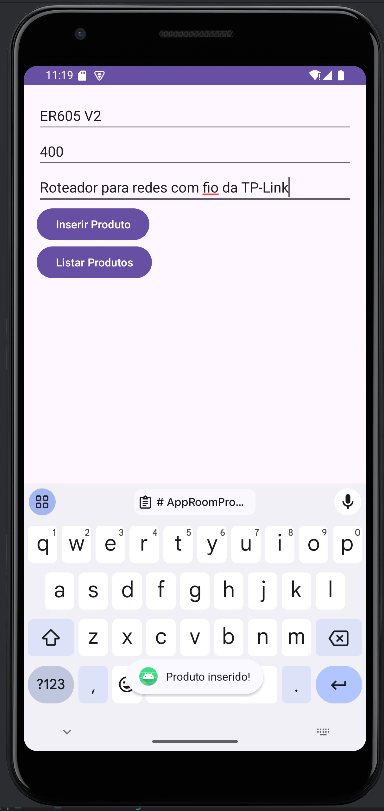
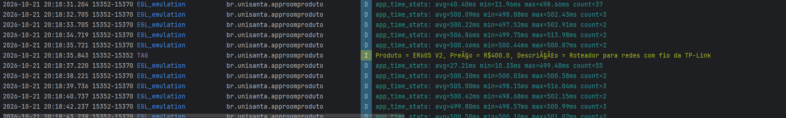
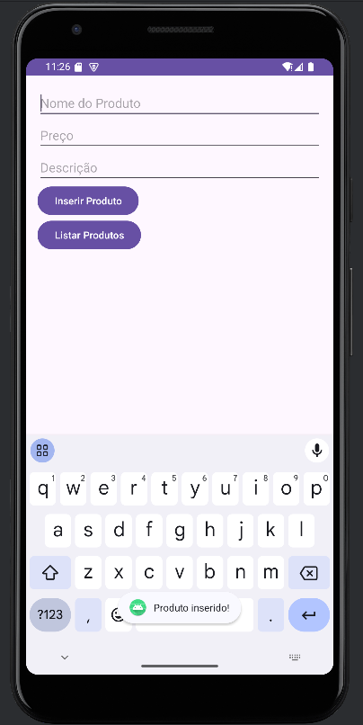
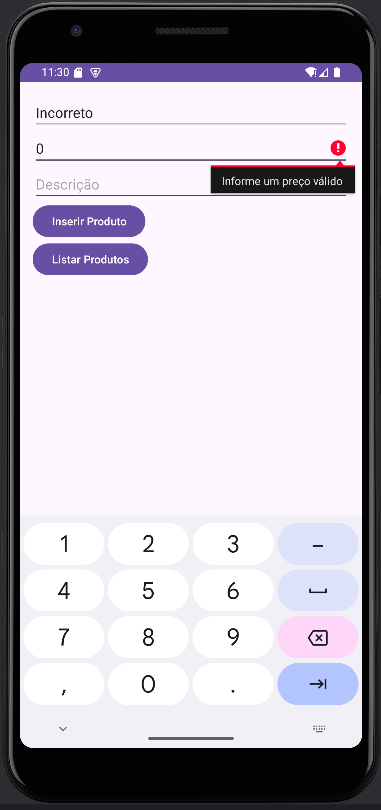
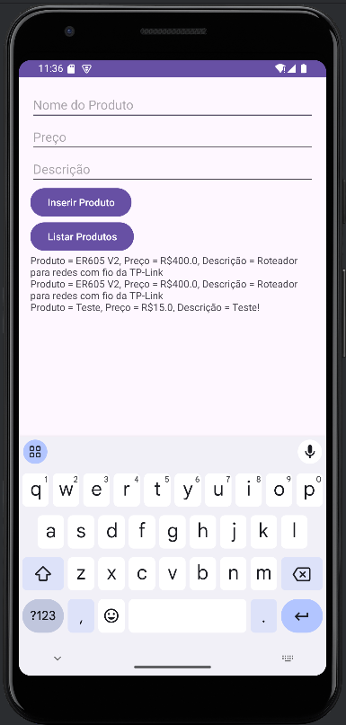
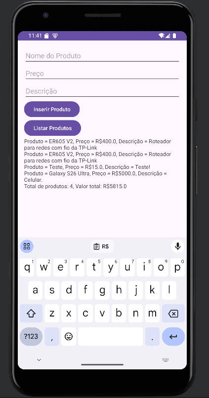
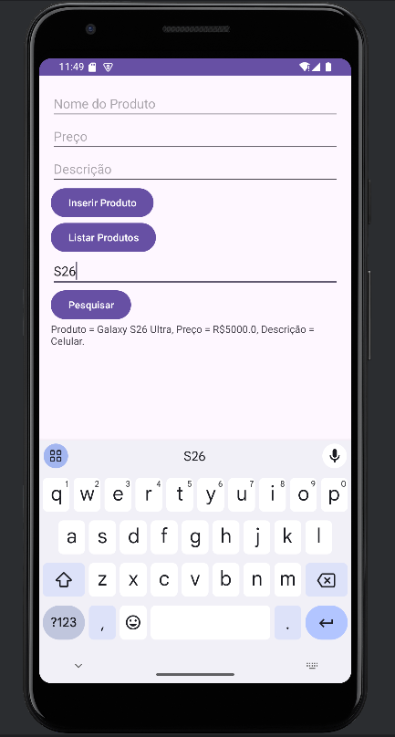
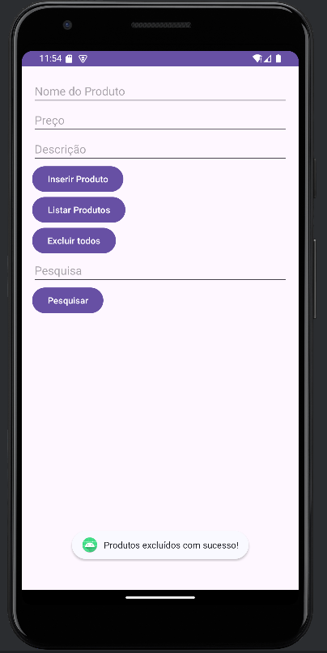
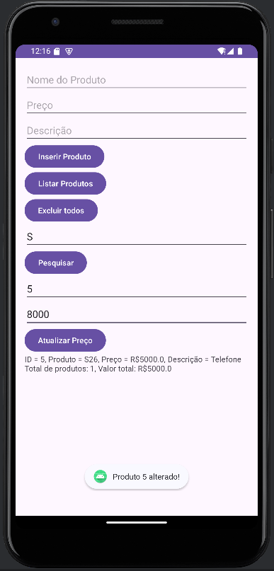
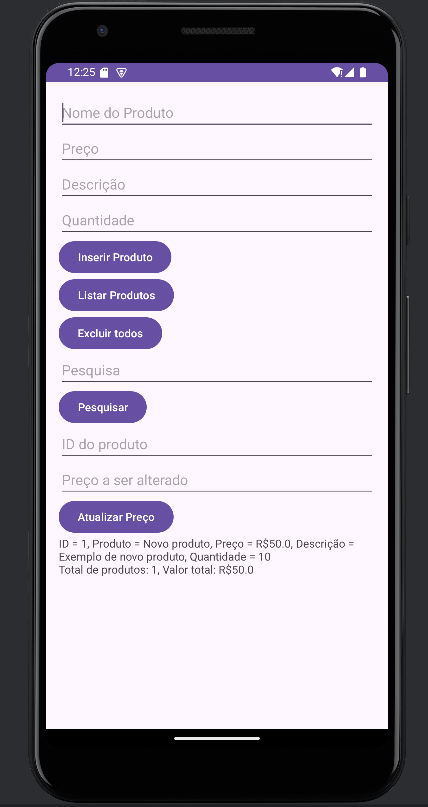

# AppRoomProduto: Cadastro de Produtos com Room SQLite

**Aluno(a):** Gabriel Pilotto, Samuel Mendes
**RA:** 241643, 239890
**Disciplina:** Programação para Dispositivos Móveis
**Professor(a):** Alessandro Ferreira Paz Lima

## Sobre o projeto

Aplicativo Android em Kotlin que cadastra e lista produtos usando persistência local com Room (SQLite).

## Tecnologias
- Kotlin
- Room 2.6.1 (SQLite)
- ViewBinding
- Corrotinas (lifecycleScope)

## Prints do app



## Parte A: Complemento prático

### A1. Limpar campos após inserir

O que foi feito: Implementamos um trecho de código que limpa os campos nome, descrição, e preço após a inserção com sucesso no banco de dados.
Trecho de código:
```kotlin
binding.editProductName.text.clear()
binding.editProductPrice.text.clear()
binding.editProductDescription.text.clear()
binding.editProductName.requestFocus()
```
Print: 

### A2. Validação de Preço

O que foi feito: Ajustamos um trecho de código para evitar a inserção de produtos com preços vazios, negativos ou com valor zero.
Trecho de código:
```kotlin
if (priceText.toDouble() > 0) {
 // ... inserção ao banco de dados
} else {
binding.editProductPrice.error = "Informe um preço válido"
}
```
Print: 

### A3. Exibição na tela

O que foi feito: Ajustamos um trecho de código para exibir uma representação da lista de produtos
Trecho de código:
```kotlin
binding.btnListarProdutos.setOnClickListener {
    // Recupera os produtos de forma assíncrona
    lifecycleScope.launch {
        binding.txvProdutos.text = ""
        val products = productDao.getAll()
        if (products.isNotEmpty()) {
            products.forEach {
                Log.i("TAG", "Produto = ${it.name}, Preço = R$${it.price}, Descrição = ${it.description}")
                binding.txvProdutos.text = binding.txvProdutos.text.toString() + "Produto = ${it.name}, Preço = R$${it.price}, Descrição = ${it.description}\n"
            }
        } else {
            Log.i("TAG", "Nenhum produto encontrado.")
        }
    }
}
```
Print: 

### A4. Total do estoque

O que foi feito: Ajustamos um trecho de código para adicionar uma exibição total de itens e a soma de seus valores.
Trecho de código:
```kotlin
binding.txvProdutos.text = binding.txvProdutos.text.toString() + "Total de produtos: ${products.size}, Valor total: R$${products.sumOf { it.price }}"
```
Print: 


### A5. Buscar por nome

O que foi feito: Adicionamos a funcionalidade de buscar itens por nome.
Trecho de código:
```kotlin
binding.btnPesquisar.setOnClickListener {
    val search = binding.editSearch.text.toString()
    lifecycleScope.launch {
        binding.txvProdutos.text = ""
        val products = productDao.buscarPorNome("%$search%")
        if (products.isNotEmpty()) {
            products.forEach {
                Log.i("TAG", "Produto = ${it.name}, Preço = R$${it.price}, Descrição = ${it.description}")
                binding.txvProdutos.text = binding.txvProdutos.text.toString() + "Produto = ${it.name}, Preço = R$${it.price}, Descrição = ${it.description}\n"
            }
        } else {
            Log.i("TAG", "Nenhum produto encontrado.")
        }
    }
}
```
Print: 

### A6. Excluir produtos

O que foi feito: Implementamos a funcionalidade de excluir todos os itens.
Trecho de código:
```kotlin
binding.btnExcluir.setOnClickListener { 
            lifecycleScope.launch { 
                productDao.deleteAll()
                Log.i("TAG", "Todos os produtos foram excluídos.")
                Toast.makeText(this@MainActivity, "Produtos excluídos com sucesso!",
                    Toast.LENGTH_SHORT).show()
            }
        }
```
Print: 

### A7. Atualização de Preço

O que foi feito: Implementamos a funcionalidade de alterar o preço de um item informando o seu ID.
Trecho de código:
```kotlin
binding.btnAtualizar.setOnClickListener {
    val productId = binding.editAtualizarId.text.toString()
    val priceText = binding.editAtualizarPreco.text.toString()

    if (productId.isNotEmpty() && priceText.isNotEmpty()) {
        if (priceText.toDouble() > 0) {
            lifecycleScope.launch {
                productDao.alterarProduto(price = priceText.toDouble(), id = productId.toInt())
                Log.i("TAG", "Produto alterado: ID = $productId, Novo preço: $priceText.")
                Toast.makeText(this@MainActivity, "Produto $productId alterado!",
                    Toast.LENGTH_SHORT).show()
            }
        } else {
            binding.editAtualizarPreco.error = "Informe um preço válido"
        }
    } else {
        Toast.makeText(this, "Preencha os campos obrigatórios!",
            Toast.LENGTH_SHORT).show()
    }
}
```
Print: 

### A8. Novo campo na tabela

O que foi feito: Implementamos o campo quantidade no banco de dados.
Trecho de código:
```kotlin
binding.btnAtualizar.setOnClickListener {
    val productId = binding.editAtualizarId.text.toString()
    val priceText = binding.editAtualizarPreco.text.toString()

    if (productId.isNotEmpty() && priceText.isNotEmpty()) {
        if (priceText.toDouble() > 0) {
            lifecycleScope.launch {
                productDao.alterarProduto(price = priceText.toDouble(), id = productId.toInt())
                Log.i("TAG", "Produto alterado: ID = $productId, Novo preço: $priceText.")
                Toast.makeText(this@MainActivity, "Produto $productId alterado!",
                    Toast.LENGTH_SHORT).show()
            }
        } else {
            binding.editAtualizarPreco.error = "Informe um preço válido"
        }
    } else {
        Toast.makeText(this, "Preencha os campos obrigatórios!",
            Toast.LENGTH_SHORT).show()
    }
}
```
Print: 

O que aconteceu com os itens: Após a alteração da versão do banco de dados, os dados anteriores foram excluídos.

## Parte B: Questões dissertativas

### B1. O que é persistência de dados...?
Resposta: Persistência de dados é a capacidade de um aplicativo de armazenar dados em um formato durável, de forma que ele permaneça cadastrado ao longo de múltiplas reinicializações. Caso os produtos fossem guardados apenas em uma mutablelist, seriam excluídos assim que o aplicativo encerrasse.

### B2. Qual a diferença de usar SQLite diretamente...?
Resposta: Diferente de utilizar uma biblioteca de conexão direta com o SQLite, utilizar o Room não exige, diretamente, a escrita de códigos SQL, pois envelopa as requisições em uma camada ORM, permitindo que a manipulação dos registros do banco seja realizada através de objetos. Entre as vantagens, pode-se citar:
1. Facilidade de integração com outras bibliotecas ORM, pois utiliza sintaxes semelhantes a outros sistemas compatíveis
2. Redução de código, pois reduz a necessidade de escrever e gerenciar queries SQL manualmente.

### B3. Explique as três partes do Room...
Resposta: As partes do Room são:
1. Entity: É o modelo de dados, definindo a estrutura de uma tabela no banco e mapeando suas colunas a propriedades da classe.
2. DAO: É a interface que permite que as camadas de negócios do projeto manipulem registros do banco de dados através de objetos. Expõe os métodos CRUD para uso no projeto.
3. Database: É o objeto que representa o banco de dados em si.
Os três componentes integram uma interface completa de gerenciamento de dados utilizando o SQLite como SGBD.

### B4. Por que o Android não permite acessar o banco de dados na thread principal...?
Resposta: A interface de UI não deve ser ocupada por tarefas demoradas, como a consulta em bancos de dados, pois ao fazê-lo, permite que o aplicativo deixe de responder para o usuário, gerando mensagens como ANR (Application Not Responding). Devido a esse problema, o Android não permite essa operação, exigindo (no caso do Kotlin) o uso do atributo `suspend` e `lifecycleScope.launch`. Semelhante aos comandos `async` e `await` em outras linguagens, são responsáveis por garantir a assincronia da operação de consulta, evitando que a thread de UI seja congelada, e delegando o processo demorado para uma thread secundária.


### B5. O que faz o fallbackToDestructiveMigration()...?
Resposta: Um fallback para migração destrutiva é método de migração que exclui os dados armazenados quando o bando de dados deve ser atualizado para uma nova versão. É perigoso, pois no caso de uma atualização final, isto significaria excluir dados dos clientes do aplicativo. Por conta disso, existem as técnicas de Migração ('migration'). São scripts ou métodos especializados em transformar os dados de uma versão antiga do banco de dados para uma versão nova.

### B6. Qual a vantagem do ViewBinding...?
Resposta: O ViewBinding tem a vantagem principal de reduzir o código e garantir a consistência dos IDs das views. Neste cenário, ao alterar os IDs de uma view, o código se recusa a compilar até que suas referências correspondentes sejam devidamente atualizadas.

### B7. Por que em apps maiores é recomendado criar o banco como Singleton...?
Resposta: Como a instância do banco de dados está contida na MainActivity, seria necessário instanciar novamente o mesmo banco em outras activities em que este seja necessário, criando inconsistências e múltiplos acessos ao mesmo objeto. Neste caso, extrair a instância a um singleton referenciado por todos os usuários do banco não apenas garante a consistência e evita a duplicidade de código, mas garante que o banco de dados opere adequadamente na aplicação.

### B8. Principais dificuldades, app real e aplicação
Resposta: A principal dificuldade encontrada foi a adição de um novo campo que, devido à estrutura atual, tornou-se desafiador devido à quantidade de referências semelhantes no mesmo arquivo. Em um caso real, seria recomendado segregar estas funções em classes distintas alinhadas a uma camada específica de negócios (BLL).

A grande maioria dos aplicativos que possuem alguma interatividade exigindo autenticação por login e senha exigem a persistência de, ao menos, uma token de acesso. Além disso, aplicativos de ferramentas locais podem exigir armazenamento no dispositivo, como por exemplo, um aplicativo de finanças pessoais. Neste caso, pela complexidade de classes (Conta, Transação, etc.) a funcionalidade de gerenciamento de dados através do Room se faz particularmente útil, podendo ser aplicada para armazenar estes dados no próprio dispositivo, ampliando a privacidade e segurança do dados processados. 

## Como executar
1. Clone o repositório
2. Abra no Android Studio
3. Execute em um emulador (API 24+)
